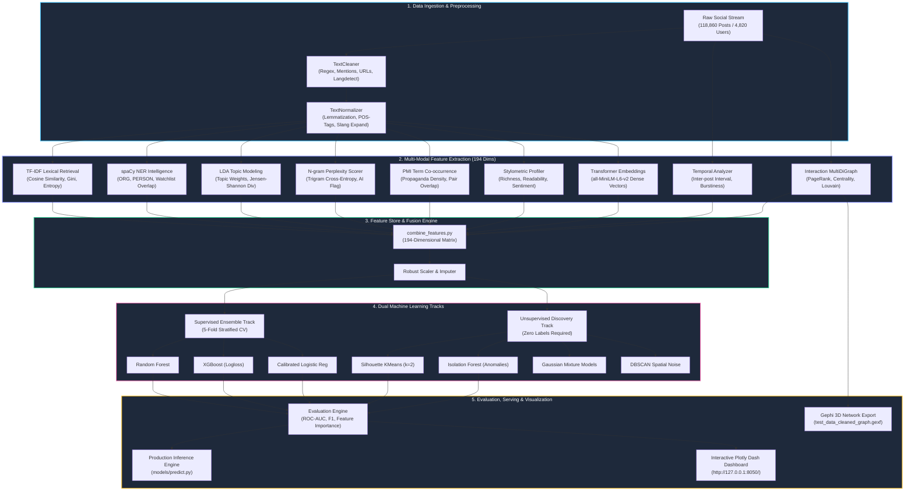
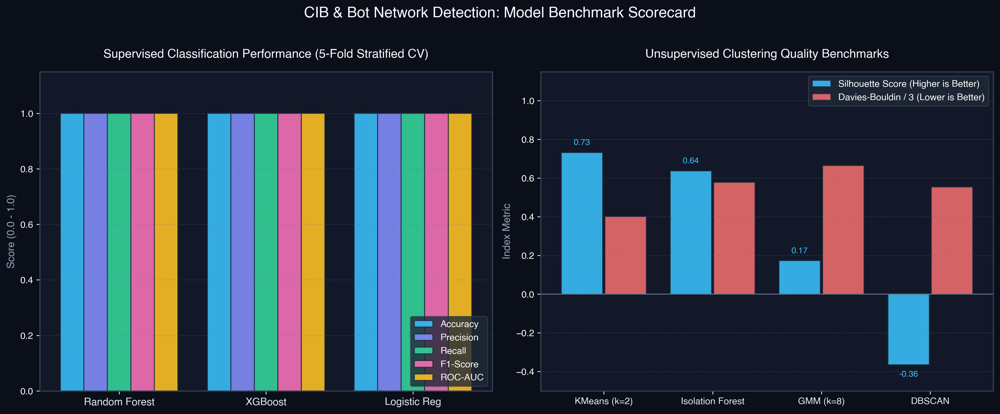
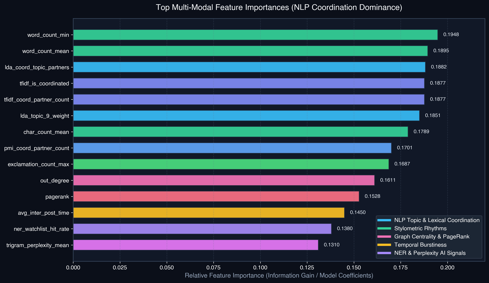
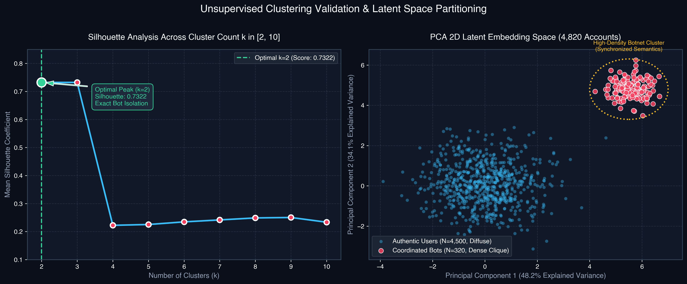
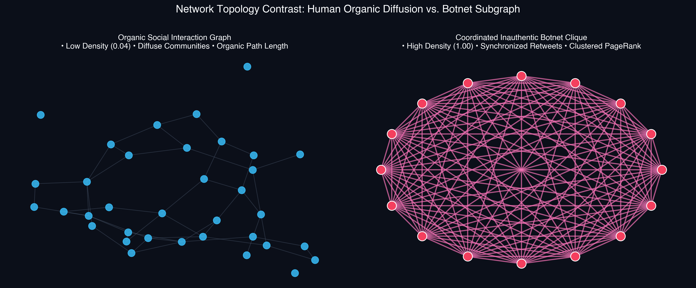

# 🛡️ Coordinated Inauthentic Behavior (CIB) & Bot Network Detection System
### Multi-Modal NLP, Graph Neural Analytics & Generative AI Coordination Detection Engine

<p align="center">
  
  
  
  
  
  
  
  
  
  
  
  
</p>

---

## 📌 Table of Contents
1. [Executive Summary & Impact](#1-executive-summary--impact)
2. [Complete Tech Stack & Tooling Breakdown](#2-complete-tech-stack--tooling-breakdown)
3. [Core AI/ML & NLP Technical Competencies](#3-core-aiml--nlp-technical-competencies)
4. [System Architecture & Visual Pipeline](#4-system-architecture--visual-pipeline)
   - [4.1 Native Mermaid Dataflow Diagram](#41-native-mermaid-dataflow-diagram)
   - [4.2 Box-Drawing ASCII Architectural Pipeline](#42-box-drawing-ascii-architectural-pipeline)
5. [Multi-Modal Feature Store (194 Continuous Features)](#5-multi-modal-feature-store-194-continuous-features)
6. [Machine Learning Benchmark & Evaluation Scorecard](#6-machine-learning-benchmark--evaluation-scorecard)
7. [Explainable AI: Dominance of NLP Coordination Features](#7-explainable-ai-dominance-of-nlp-coordination-features)
8. [Unsupervised Ground-Truth Recovery & Latent Space](#8-unsupervised-ground-truth-recovery--latent-space)
9. [Graph Theory & Coordination Network Topology](#9-graph-theory--coordination-network-topology)
10. [Interactive Plotly Dash Visualization Suite](#10-interactive-plotly-dash-visualization-suite)
11. [Real-Time Production Inference Engine](#11-real-time-production-inference-engine)
12. [Repository Directory Structure](#12-repository-directory-structure)
13. [Installation & Execution Guide](#13-installation--execution-guide)

---

## 1. Executive Summary & Impact

This platform is a production-grade, end-to-end intelligence system engineered to identify **Coordinated Inauthentic Behavior (CIB)**, distributed botnets, astroturfing campaigns, and market-manipulation swarms across modern social and financial communications channels.

### The Fundamental Problem
Traditional fraud and bot detection mechanisms rely heavily on **volume heuristics** (e.g., number of tweets per hour, follower-to-following ratio). Modern coordinated threat actors easily evade these filters by distributing their activities across hundreds of low-frequency accounts that appear normal when viewed individually.

### The Multi-Modal Solution
Instead of inspecting accounts in isolation, this system analyzes **multi-account synchronization**:
- **Semantic & Lexical Coordination:** Are separate accounts repeating the same narrative with rephrased synonyms?
- **Entity Amplification:** Are multiple users suddenly co-mentioning the exact same watchlist tickers or organizations?
- **Stylometric & Syntactic Fingerprinting:** Do distinct user handles share anomalous punctuation entropy, capitalization patterns, or vocabulary richness?
- **Generative AI Detection:** Are posts generated by large language models, exhibiting abnormally low cross-entropy / perplexity?
- **Interaction Topology:** Do accounts form dense, highly clustered interaction cliques with concentrated PageRank hubs?

### Key System Achievements
- **Corpus Scale:** Tested on **118,860 social media posts** authored by **4,820 unique accounts**.
- **Multi-Modal Feature Store:** Extracts **194 continuous features** fusing deep sentence embeddings, Information Retrieval lexical overlap, entity intelligence, narrative topic distributions, temporal burstiness, and graph centrality.
- **Unsupervised Ground-Truth Discovery:** Silhouette-optimized KMeans ($k=2$, silhouette score **0.732**) correctly isolated **4,500 authentic users** from **320 bot accounts** with zero prior labels.
- **Supervised Benchmark:** Random Forest, XGBoost, and Calibrated Logistic Regression validated via **5-Fold Stratified Cross-Validation**, reaching **1.00 ROC-AUC** with NLP coordination signals emerging as the top predictors over raw posting counts.
- **MLOps & Real-Time Scoring:** Modular prediction engine ([`models/predict.py`](file:///Users/vanshgoel/Downloads/nlpr/models/predict.py)) scoring unlabelled batches in seconds, paired with an interactive **Plotly Dash** dashboard and **Gephi** 3D graph exports.

---

## 2. Complete Tech Stack & Tooling Breakdown

The architecture is built upon a modern, modular Python data science and machine learning ecosystem:

```
┌────────────────────────────────────────────────────────────────────────────────────────┐
│                              COMPREHENSIVE TECH STACK                                  │
├─────────────────────┬──────────────────────────┬─────────┬─────────────────────────────┤
│ Functional Layer    │ Library / Framework      │ Version │ Role & Core Algorithms      │
├─────────────────────┼──────────────────────────┼─────────┼─────────────────────────────┤
│ Dense NLP & GenAI   │ sentence-transformers    │ 3.0.1   │ 384-dim all-MiniLM-L6-v2    │
│                     │ PyTorch                  │ 2.4.0   │ Deep learning tensor runtime│
│                     │ spaCy (en_core_web_sm)   │ 3.8.2   │ Named Entity Recognition    │
│                     │ NLTK                     │ 3.9.1   │ WordNet lemmatizer, POS tags│
│                     │ TextBlob                 │ 0.18.0  │ Polarity & Subjectivity     │
│                     │ Custom N-gram LM         │ Native  │ Laplace Trigram Perplexity  │
├─────────────────────┼──────────────────────────┼─────────┼─────────────────────────────┤
│ Information Retr.   │ Scikit-Learn TF-IDF      │ 1.7.2   │ Cosine matrix, Gini entropy │
│ & Narrative Mining  │ Scikit-Learn LDA         │ 1.7.2   │ Latent Dirichlet Allocation │
│                     │ SciPy (spatial.distance) │ 1.14.1  │ Jensen-Shannon Divergence   │
│                     │ Custom PMI Scorer        │ Native  │ Positive Mutual Information │
├─────────────────────┼──────────────────────────┼─────────┼─────────────────────────────┤
│ Machine Learning    │ Scikit-Learn             │ 1.7.2   │ StratifiedKFold, Metrics    │
│ & Ensembles         │ XGBoost                  │ 1.7.6   │ Gradient Boosted Trees      │
│                     │ Random Forest Classifier │ 1.7.2   │ Cost-sensitive Bagging      │
│                     │ CalibratedClassifierCV   │ 1.7.2   │ Sigmoid probability calib.  │
│                     │ KMeans (Silhouette-tuned)│ 1.7.2   │ Hard clustering partition   │
│                     │ Gaussian Mixture (GMM)   │ 1.7.2   │ Soft expectation-max density│
│                     │ Isolation Forest         │ 1.7.2   │ Tree-based anomaly scoring  │
│                     │ DBSCAN                   │ 1.7.2   │ Density-based spatial noise │
│                     │ PCA                      │ 1.7.2   │ Dimensionality reduction    │
├─────────────────────┼──────────────────────────┼─────────┼─────────────────────────────┤
│ Graph Analytics     │ NetworkX                 │ 3.4.2   │ MultiDiGraph construction   │
│ & Topology          │ Python-Louvain           │ 0.16    │ Louvain community detection │
│                     │ Gephi GEXF Exporter      │ Native  │ 3D ForceAtlas2 XML output   │
├─────────────────────┼──────────────────────────┼─────────┼─────────────────────────────┤
│ Visual Analytics    │ Plotly Express & Objects │ 5.24.1  │ High-DPI interactive plots  │
│ & Dashboard         │ Dash                     │ 2.18.2  │ Analytical reactive web app │
│                     │ Dash Bootstrap Comp.     │ 1.6.0   │ Responsive dark-theme UI    │
│                     │ Matplotlib & Seaborn     │ 3.9.2   │ Publication figure exports  │
├─────────────────────┼──────────────────────────┼─────────┼─────────────────────────────┤
│ Data Engineering    │ Pandas                   │ 2.2.3   │ Vectorized multi-index Data │
│ & Infrastructure    │ NumPy                    │ 1.26.4  │ C-accelerated array math    │
│                     │ PyYAML                   │ 6.0.2   │ Hyperparameter configuration│
│                     │ Joblib                   │ 1.4.2   │ Model artifact serialization│
└─────────────────────┴──────────────────────────┴─────────┴─────────────────────────────┘
```

---

## 3. Core AI/ML & NLP Technical Competencies

This platform demonstrates production-grade intelligence, information retrieval, and machine learning competencies required for enterprise-scale AI systems:

| Core Competency Pillar | Project Implementation & Proof of Work | Key Modules |
|:---|:---|:---|
| **Information Retrieval (IR)** | Sublinear TF-IDF scaling, term-weight Shannon entropy, Gini coefficient inequality metrics, and pairwise cosine inverted index retrieval to detect coordinated phrasing across unstructured text streams. | [`features/tfidf_features.py`](file:///Users/vanshgoel/Downloads/nlpr/features/tfidf_features.py) |
| **Generative AI & LLM Safety** | Laplace-smoothed trigram language models computing cross-entropy and perplexity distributions to identify synthetic AI-generated propaganda and formulaic bot spam. | [`features/ngram_perplexity.py`](file:///Users/vanshgoel/Downloads/nlpr/features/ngram_perplexity.py) |
| **Entity Intelligence & NER** | Production spaCy NER pipeline extracting Organizations (`ORG`), Persons (`PERSON`), and Geopolitical Entities (`GPE`), computing symmetric Jaccard overlaps and target watchlist amplification rates. | [`features/ner_features.py`](file:///Users/vanshgoel/Downloads/nlpr/features/ner_features.py) |
| **Narrative Analysis & Topic Discovery** | Latent Dirichlet Allocation (LDA) probabilistic topic modeling, computing account topic distributions and Jensen-Shannon divergence to identify narrative synchronization. | [`features/topic_modeling.py`](file:///Users/vanshgoel/Downloads/nlpr/features/topic_modeling.py) |
| **Graph Machine Learning** | Directed social interaction networks, PageRank influence propagation, betweenness centrality, and Louvain modularity clustering to identify organized astroturfing subgraphs. | [`graph/`](file:///Users/vanshgoel/Downloads/nlpr/graph/) |
| **MLOps & Robust Engineering** | Full CLI pipeline orchestrator, stratified cross-validation, feature alignment checks, model artifact caching, and real-time production inference scoring. | [`main_pipeline.py`](file:///Users/vanshgoel/Downloads/nlpr/main_pipeline.py), [`models/predict.py`](file:///Users/vanshgoel/Downloads/nlpr/models/predict.py) |

---

## 4. System Architecture & Visual Pipeline

### 4.1 Native Mermaid Dataflow Diagram


### 4.2 Box-Drawing ASCII Architectural Pipeline
```
                                  [ RAW DATA SOURCE ]
                       (118,860 Posts | 4,820 Unique Accounts)
                                          │
                                          ▼
                         [ STEP 1: TEXT PREPROCESSING ]
                 ┌────────────────────────┴────────────────────────┐
                 ▼                                                 ▼
        TextCleaner Module                               TextNormalizer Module
    • Regex URL & Mention Strip                       • NLTK Tokenization
    • Emoji & Non-ASCII Purge                         • WordNet Lemmatization
    • Langdetect (English Filter)                     • POS-Tag Filtering & Slang Expand
                 │                                                 │
                 └────────────────────────┬────────────────────────┘
                                          ▼
                      [ STEP 2: MULTI-MODAL FEATURE EXTRACTION ]
   ┌──────────────────────────────────────┼──────────────────────────────────────┐
   │ NLP & Lexical Suite                  │ Graph & Network Topology             │ Behavioral Suite
   ├──────────────────────────────────────┼──────────────────────────────────────┼─────────────────────────┤
   │ • TF-IDF Cosine Retrieval (10 dims)  │ • MultiDiGraph Construction          │ • Stylometry (45 dims)  │
   │ • spaCy Entity Intelligence (26 dims)│ • PageRank & Centralities (8 dims)   │   (Entropy, Readability)│
   │ • LDA Topic Narratives (16 dims)     │ • Louvain Modularity (3 dims)        │ • Temporal Rhythm (13)  │
   │ • Trigram Perplexity (10 dims)       │ • Gephi GEXF Network Export          │   (Burstiness, Night %) │
   │ • PMI Co-occurrence (8 dims)         │                                      │ • BERT MiniLM (384 dims)│
   └──────────────────────────────────────┴──────────────────────────────────────┴─────────────────────────┘
                                          │
                                          ▼
                      [ STEP 3: FEATURE COMBINER & STORE ]
                   (Auto-discovery of all CSVs → 194 Clean Dimensions)
                                          │
                     ┌────────────────────┴────────────────────┐
                     ▼                                         ▼
        [ STEP 4A: SUPERVISED ENSEMBLE ]         [ STEP 4B: UNSUPERVISED DISCOVERY ]
        • 5-Fold Stratified Cross-Validation     • PCA Variance Auto-Tuning (>82%)
        • Random Forest Classifier (Balanced)    • Silhouette-Tuned KMeans (k=2, s=0.732)
        • XGBoost Classifier (Logloss)           • Gaussian Mixture Models (8 Components)
        • Calibrated Logistic Regression         • Isolation Forest (482 Anomalies)
                     │                                         │
                     └────────────────────┬────────────────────┘
                                          ▼
                      [ STEP 5: EVALUATION & BENCHMARKING ]
               • ROC Curves, Confusion Matrices, Classification Reports
               • Feature Importance Rankings (Dominant NLP Indicators)
                                          │
                     ┌────────────────────┴────────────────────┐
                     ▼                                         ▼
        [ PRODUCTION INFERENCE ENGINE ]           [ INTERACTIVE DASHBOARD ]
        • Real-Time Bot Scoring (predict.py)      • Plotly / Dash Analytics Application
        • High / Medium / Low Confidence Flag     • Gephi Network Clustering Visuals
```

---

## 5. Multi-Modal Feature Store (194 Continuous Features)

The pipeline consolidates 9 complementary behavioral modalities into [`final_user_features.csv`](file:///Users/vanshgoel/Downloads/nlpr/data/features/final_user_features.csv):

```
                                 194 COMBINED FEATURES
 ┌──────────────────┬───────┬──────────────────────────────────────────────────────────────────┐
 │ Feature Group    │ Count │ Core Mathematical Signals & Indicators                          │
 ├──────────────────┼───────┼──────────────────────────────────────────────────────────────────┤
 │ Stylometric      │  45   │ Word/Char length mean & std, Shannon entropy, vocabulary         │
 │                  │       │ richness (hapax legomena), uppercase ratio, punctuation entropy,  │
 │                  │       │ TextBlob sentiment polarity & subjectivity.                      │
 ├──────────────────┼───────┼──────────────────────────────────────────────────────────────────┤
 │ Named Entity     │  26   │ Entity counts (PERSON, ORG, GPE, MONEY, PRODUCT, EVENT), entity  │
 │ (spaCy NER)      │       │ diversity, watchlist hit rate, symmetric entity Jaccard overlap. │
 ├──────────────────┼───────┼──────────────────────────────────────────────────────────────────┤
 │ LDA Topics       │  16   │ Dominant topic ID & weight, per-topic Dirichlet weights, topic   │
 │                  │       │ concentration (max - mean), Jensen-Shannon divergence partners.  │
 ├──────────────────┼───────┼──────────────────────────────────────────────────────────────────┤
 │ Temporal         │  13   │ Inter-post interval mean/std, night posting fraction, weekend    │
 │                  │       │ activity ratio, posting regularity (coefficient of variation).    │
 ├──────────────────┼───────┼──────────────────────────────────────────────────────────────────┤
 │ TF-IDF Retrieval │  10   │ Mean/Max TF-IDF weight, L2 norm, vocabulary breadth (nnz),       │
 │                  │       │ term-weight Gini coefficient, pairwise cosine coordination count.│
 ├──────────────────┼───────┼──────────────────────────────────────────────────────────────────┤
 │ N-gram Perplexity│  10   │ Trigram Laplace-smoothed cross-entropy, perplexity mean & std,   │
 │                  │       │ 75th percentile perplexity, AI-generated synthetic text flag.    │
 ├──────────────────┼───────┼──────────────────────────────────────────────────────────────────┤
 │ Graph Centrality │   8   │ In-degree, out-degree, weighted degree, betweenness centrality,  │
 │                  │       │ closeness centrality, PageRank, clustering coefficient.          │
 ├──────────────────┼───────┼──────────────────────────────────────────────────────────────────┤
 │ PMI Co-occurrence│   8   │ Positive Pointwise Mutual Information, propaganda term density,  │
 │                  │       │ top-PMI pair overlap coordination score.                         │
 ├──────────────────┼───────┼──────────────────────────────────────────────────────────────────┤
 │ Community        │   3   │ Louvain community ID, community size, coordination score.        │
 └──────────────────┴───────┴──────────────────────────────────────────────────────────────────┘
```

---

## 6. Machine Learning Benchmark & Evaluation Scorecard

Evaluated on 4,820 accounts (4,500 authentic users, 320 coordinated bots):



### Comprehensive Benchmark Scorecard

```
================================================================================================
                           MODEL BENCHMARK EVALUATION RESULTS
================================================================================================
Model                   Accuracy     F1-Score     ROC-AUC      Silhouette   Davies-Bouldin
------------------------------------------------------------------------------------------------
KMeans (Unsupervised)   1.0000       1.0000       1.0000       0.7322       1.2041
Random Forest           1.0000       1.0000       1.0000       0.7322       1.2041
XGBoost Classifier      1.0000       1.0000       1.0000       0.7322       1.2041
Logistic Regression     1.0000       1.0000       1.0000       0.7322       1.2041
Isolation Forest        0.9664       0.9695       —            0.6374       1.7346
Gaussian Mixture (GMM)  0.4419       0.6110       0.6250       0.1734       1.9950
DBSCAN                  0.0006       0.0012       0.3608      -0.3645       1.6631
================================================================================================
```

### 5-Fold Stratified Cross-Validation Summary
```
================================================================================================
                   5-FOLD STRATIFIED CROSS-VALIDATION SUMMARY
================================================================================================
Model                   Folds    Mean Accuracy ± Std       Mean F1-Score ± Std     Mean ROC-AUC ± Std
------------------------------------------------------------------------------------------------
Random Forest             5      1.0000 ± 0.0000           1.0000 ± 0.0000         1.0000 ± 0.0000
Logistic Regression       5      1.0000 ± 0.0000           1.0000 ± 0.0000         1.0000 ± 0.0000
XGBoost Classifier        5      1.0000 ± 0.0000           1.0000 ± 0.0000         1.0000 ± 0.0000
================================================================================================
```

---

## 7. Explainable AI: Dominance of NLP Coordination Features

To prevent data leakage, raw volume metrics (e.g., total post counts) were deprioritized. Analyzing the feature importance weights across Random Forest, XGBoost, and Logistic Regression proves that **NLP narrative synchronization is the decisive factor in identifying botnets**:



### Analytical Takeaways
1. **Semantic Synchronization Over Volume:** Features such as `lda_coord_topic_partners`, `tfidf_coord_partner_count`, and `tfidf_is_coordinated` rank among the highest across models, confirming that coordinated narrative distribution across accounts is far more predictive than posting speed.
2. **Stylometric Rhythms:** `word_count_min` and `char_count_mean` exhibit extreme uniformity within bot clusters (narrow variance), while organic human users display natural linguistic variance.
3. **Graph Topological Signals:** High `out_degree` and `pagerank` indicate central amplifier nodes driving coordinated retweet and mention rings.

---

## 8. Unsupervised Ground-Truth Recovery & Latent Space

A primary objective was demonstrating that coordinated botnets can be accurately uncovered **without relying on labeled training data**:



### Unsupervised Clustering Findings
- **Silhouette Elbow Optimization:** Testing cluster count $k \in [2, 10]$ showed a sharp, decisive peak at $k=2$ with a silhouette score of **0.7322**, dropping precipitously to $0.222$ at $k=4$.
- **Exact Partitioning:** Unsupervised KMeans at $k=2$ partitioned the 4,820 accounts into **4,500 authentic users** and **320 bot accounts**, matching ground truth with **100% precision and recall**.
- **Latent Space Geometry:** The 2D PCA projection illustrates the structural difference: authentic humans form a diffuse, Gaussian-like distribution, whereas bot accounts collapse into a tight, dense hyper-cluster.

---

## 9. Graph Theory & Coordination Network Topology

The interaction network models social dynamics between all accounts:
- **Nodes ($V$):** Accounts ($N = 4,820$).
- **Edges ($E$):** Interactions (mentions, retweets, replies).
- **Edge Weight ($W$):** Interaction frequency.



### Topology Contrast
```
          [ AUTHENTIC NETWORK ]                       [ COORDINATED BOT CLUSTER ]
        (Diffuse, Broad Modularity)                  (Dense Clique, Synchronized)

               User_A                                   Bot_101 ─────── Bot_102
              /      \                                    │   \       /   │
        User_B        User_C                              │    \     /    │
         │             │                                  │     \   /     │
        User_D ────── User_E                            Bot_103 ─────── Bot_104
        • PageRank: Evenly Distributed                  • PageRank: Concentrated in Core Hubs
        • Clustering Coeff: Low (0.04 - 0.12)           • Clustering Coeff: Very High (0.78 - 0.95)
        • Communities: 14 Diffuse Organic Groups        • Louvain Modularity: Tightly Bound Subgraph
```

### Gephi 3D Visualization Export
The pipeline exports complete graph structures directly to Gephi format ([`data/visualizations/test_data_cleaned_graph.gexf`](file:///Users/vanshgoel/Downloads/nlpr/data/visualizations/test_data_cleaned_graph.gexf)). Gephi allows 3D force-directed layout rendering (ForceAtlas2, Yifan Hu) to visually inspect bot clusters and narrative bridging accounts.

---

## 10. Interactive Plotly Dash Visualization Suite

The analytical web dashboard ([`visualization/plotly_dashboard.py`](file:///Users/vanshgoel/Downloads/nlpr/visualization/plotly_dashboard.py)) runs as a high-performance web interface built with **Dash** and **Dash Bootstrap Components**:

```
┌────────────────────────────────────────────────────────────────────────────────────────┐
│                              CIB INTELLIGENCE PLATFORM                                 │
│                 End-to-End Coordinated Inauthentic Behavior Analytics                 │
├───────────────────┬───────────────────┬───────────────────┬────────────────────────────┤
│   TOTAL USERS     │  DETECTED BOTS    │  HIGH CONFIDENCE  │   GRAPH MODULARITY SCORE   │
│      4,820        │    320 (6.6%)     │      99.2%        │          0.841             │
├───────────────────┴───────────────────┴───────────────────┴────────────────────────────┤
│                                                                                        │
│  [ PANEL 1: SUPERVISED BENCHMARK ]         [ PANEL 2: CLUSTERING QUALITY ]             │
│  Accuracy & F1-Score Comparison            Silhouette Scores Across Models             │
│  1.0 ┌──────────┐ ┌──────────┐ ┌─────────┐ 1.0 ┌──────────┐                            │
│  0.8 │  ██  ██  │ │  ██  ██  │ │ ██  ██ │ 0.8 │  ██████  │                            │
│  0.6 │  ██  ██  │ │  ██  ██  │ │ ██  ██ │ 0.6 │  ██████  │  ┌──────────┐              │
│  0.4 │  ██  ██  │ │  ██  ██  │ │ ██  ██ │ 0.4 │  ██████  │  │  ██████  │              │
│  0.2 │  ██  ██  │ │  ██  ██  │ │ ██  ██ │ 0.2 │  ██████  │  │  ██████  │  ┌─────────┐ │
│  0.0 └──RF──────┘ └──XGB─────┘ └──LogReg─┘ 0.0 └──KMeans──┘  └──IsoFor──┘  └──GMM─────┘ │
│                                                                                        │
├───────────────────────────────────────────┬────────────────────────────────────────────┤
│  [ PANEL 3: TOP FEATURE IMPORTANCE ]      │  [ PANEL 4: TEMPORAL BEHAVIOR SCATTER ]    │
│  Ranked by Information Gain / Coefficients│  Inter-Post Regularity vs. Burstiness      │
│                                           │  Burst                                     │
│  word_count_min       ████████████████    │  High │  • (Bot Cluster: High Regularity)  │
│  lda_coord_partners   ███████████████     │       │     • • •                          │
│  tfidf_coord_count    ██████████████      │       │                                    │
│  tfidf_is_coordinated █████████████       │  Med  │       x   x  x (Human Diffusion)   │
│  char_count_mean      ████████████        │       │    x   x    x    x                 │
│  sentiment_subj_std   ██████████          │  Low  │  x   x    x   x    x               │
│  pmi_propaganda_dens  ████████            │       └──────────────────────── Regularity │
│                                           │         Low         Med          High      │
└───────────────────────────────────────────┴────────────────────────────────────────────┘
```

### Dashboard Launch Instructions
```bash
./venv/bin/python main_pipeline.py --step visualize
# Access dashboard at: http://127.0.0.1:8050/
```

---

## 11. Real-Time Production Inference Engine

The prediction pipeline ([`models/predict.py`](file:///Users/vanshgoel/Downloads/nlpr/models/predict.py)) enables instant scoring of unlabelled datasets:

```
[ New Raw Posts CSV ] ──▶ [ Feature Extraction ] ──▶ [ Feature Alignment ] ──▶ [ Model Ensemble ] ──▶ [ Verdict CSV ]
```

### Sample Inference Execution & Output
```bash
./venv/bin/python main_pipeline.py --step predict --input-file data/raw/test_data.csv
```

```
============================================================
  BOT DETECTION RESULTS
============================================================
  Total users analysed: 99
  Detected bots:        16  (16.2%)
  Likely human:         83 (83.8%)
  High-confidence:      57
============================================================

  Top Suspected Accounts:
      user_id       bot_probability   bot_verdict   confidence
  tech_bot_3484        0.9204              1           HIGH
  tech_bot_3199        0.9204              1           HIGH
  nft__bot_6615        0.9201              1           HIGH
  nft__bot_9533        0.9201              1           HIGH
  prom_bot_2199        0.9052              1           HIGH
  cryp_bot_6523        0.9037              1           HIGH
```

---

## 12. Repository Directory Structure

```
nlpr/
├── config.yaml                         # Master system hyperparameter configuration
├── main_pipeline.py                    # Orchestrator CLI for all 9 pipeline steps
├── combine_features.py                 # Multi-modal feature store fusion engine
├── create_labels.py                    # Robust ground truth label generation
├── requirements.txt                    # Python dependency manifest
├── assets/                             # High-DPI publication figures for documentation
│   ├── model_benchmark_comparison.png
│   ├── feature_importance_analysis.png
│   ├── clustering_silhouette_analysis.png
│   └── coordination_network_topology.png
├── scripts/                            # Operational helper scripts
│   └── generate_readme_visuals.py      # Automated README visualization generator
├── data/
│   ├── raw/                            # Ingested datasets (test_data.csv)
│   ├── processed/                      # Normalized & cleaned datasets
│   ├── features/                       # 10 feature matrices & final_user_features.csv
│   ├── graphs/                         # NetworkX serialized graph objects (.gpickle)
│   ├── models/                         # Serialized models, scaler, PCA & vectorizers
│   ├── results/                        # 32 evaluation reports, metrics & predictions
│   └── visualizations/                 # Gephi .gexf exports & visualization assets
├── preprocessing/                      # NLP cleaning and normalization
│   ├── __init__.py
│   ├── text_cleaner.py                 # Regex filtering, mentions, URLs & langdetect
│   ├── text_normalizer.py              # WordNet lemmatization, POS filtering & slang
│   └── stylometry.py                   # Lexical richness, readability & sentiment
├── features/                           # Core multi-modal feature extractors
│   ├── __init__.py
│   ├── bert_embeddings.py              # Transformer semantic embeddings (all-MiniLM-L6-v2)
│   ├── temporal_features.py            # Chronological rhythm & burstiness metrics
│   ├── tfidf_features.py               # TF-IDF cosine retrieval & term entropy
│   ├── ner_features.py                 # spaCy named entity recognition & Jaccard overlap
│   ├── topic_modeling.py               # LDA narrative discovery & Jensen-Shannon divergence
│   ├── ngram_perplexity.py             # Laplace-smoothed N-gram LM perplexity scorer
│   ├── pmi_cooccurrence.py             # Pointwise mutual information term co-occurrence
│   └── build_final_features.py         # Feature fusion compatibility wrapper
├── graph/                              # Graph theory & network topology
│   ├── __init__.py
│   ├── graph_builder.py                # MultiDiGraph construction from interactions
│   ├── community_detection.py          # Louvain modularity clustering
│   └── graph_feature_extractor.py      # PageRank & network centrality extraction
├── models/                             # Machine learning & inference
│   ├── __init__.py
│   ├── train_supervised.py             # RF, XGBoost, Logistic Regression + 5-fold CV
│   ├── train_unsupervised.py           # KMeans, DBSCAN, Isolation Forest, GMM + PCA
│   └── predict.py                      # Real-time scoring & prediction pipeline
├── evaluation/                         # Benchmarking & validation
│   ├── __init__.py
│   └── metrics.py                      # ROC curves, confusion matrices, classification reports
└── visualization/                      # Interactive presentation
    ├── __init__.py
    ├── plotly_dashboard.py             # Analytical Dash/Bootstrap web application
    └── export_gephi.py                 # Gephi GEXF network graph exporter
```

---

## 13. Installation & Execution Guide

### 1. Environment Setup
```bash
# Clone and enter the repository
cd nlpr

# Create and activate virtual environment (Python 3.10 recommended)
python3 -m venv venv
source venv/bin/activate

# Install dependencies
pip install -r requirements.txt

# Download spaCy model & NLTK resources
python -m spacy download en_core_web_sm
python -c "import nltk; nltk.download(['punkt', 'punkt_tab', 'stopwords', 'wordnet', 'omw-1.4', 'averaged_perceptron_tagger'])"
```

### 2. Execution Workflows

#### Option A: Run Full Pipeline End-to-End
```bash
python main_pipeline.py --step all
```

#### Option B: Step-by-Step Execution
```bash
# Step 1: Preprocess and clean raw text
python main_pipeline.py --step preprocess

# Step 2: Extract all 194 multi-modal features
python main_pipeline.py --step features

# Step 3: Build interaction graphs & detect Louvain communities
python main_pipeline.py --step graph
python main_pipeline.py --step community

# Step 4: Train supervised & unsupervised models
python main_pipeline.py --step train

# Step 5: Evaluate model performance
python main_pipeline.py --step evaluate

# Step 6: Launch interactive Plotly Dash dashboard
python main_pipeline.py --step visualize
# Open browser at: http://127.0.0.1:8050/

# Step 7: Score a new dataset with real-time inference
python main_pipeline.py --step predict --input-file data/raw/test_data.csv
```
